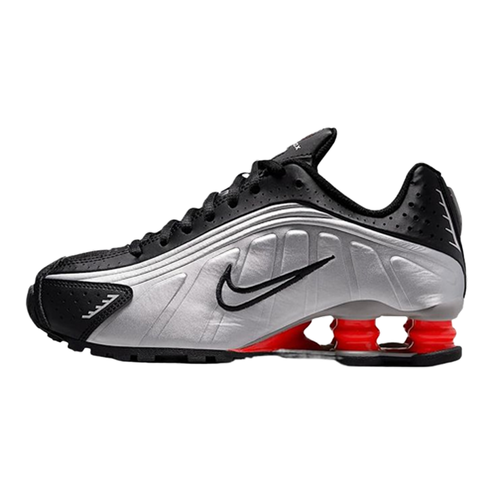
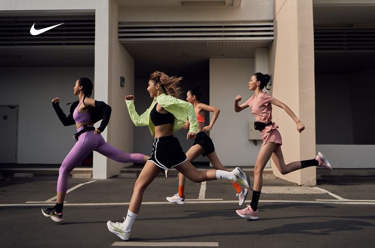
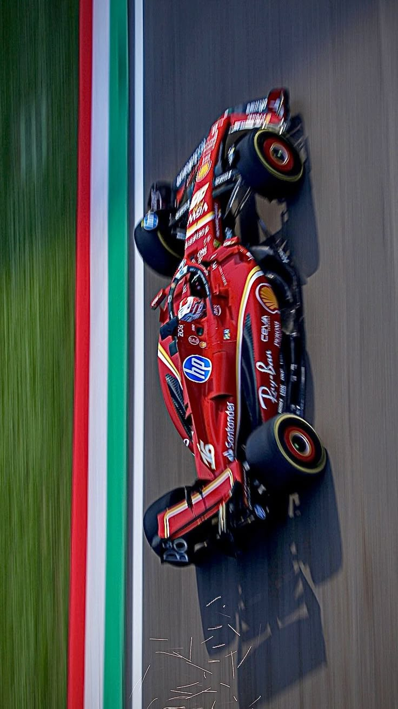

# 📚 DOKUMENTASI FITUR - TOKO SEPATU

---

## 📋 DAFTAR ISI

1. [Fitur Category Dropdown](#1-fitur-category-dropdown)
2. [Fitur Favorite / Wishlist](#2-fitur-favorite--wishlist)
3. [Fitur Add to Cart](#3-fitur-add-to-cart)
4. [Fitur Notifikasi](#4-fitur-notifikasi)
5. [Fitur Checkout & Pembayaran](#5-fitur-checkout--pembayaran)
6. [Fitur Notifikasi Pembayaran](#6-fitur-notifikasi-pembayaran-selesai)
7. [Fitur Auto Scroll](#7-fitur-auto-scroll-ke-section-produk)
8. [Fitur Lainnya](#8-fitur-lainnya)
   - [Carousel](#-carousel--image-slider)
   - [Smooth Scroll](#-smooth-scroll)
   - [Active Navigation State](#-active-navigation-state)
   - [Sticky Navbar](#-sticky-navbar)
   - [Responsive Design](#-responsive-design)

---

## 1. FITUR CATEGORY DROPDOWN

### 📍 Lokasi di Website

- Terletak di **navbar (header)** bagian atas sebelah kanan
- Berisi menu untuk filter produk berdasarkan **brand**

### 🎯 Fungsi Utama

Memungkinkan customer memfilter/menyaring produk berdasarkan brand yang diinginkan:

- **Semua Produk** (menampilkan semua brand)
- **Casual** (hanya produk Casual)
- **Football** (hanya produk Football)
- **Running** (hanya produk Running)

### 🔧 Cara Kerja

```
1. User klik menu "Category" di navbar
   ↓
2. Dropdown menu muncul dengan 4 pilihan brand
   ↓
3. User klik salah satu jenis (misal: Casual)
   ↓
4. Website secara otomatis menampilkan HANYA Sepatu Berjenis Casual
5. Produk brand lain disembunyikan/tidak terlihat
   ↓
6. Page scroll otomatis ke section produk
```

### 💾 Data yang Digunakan

- Setiap produk card memiliki **atribut `data-brand`**
- Contoh: `<div class="product-card" data-brand="nike">`
- Dropdown menu mencari & menampilkan produk dengan `data-brand` yang cocok

### 🎨 Tampilan Visual

```
┌─────────────────┐
│   CATEGORY ▼    │  ← Tombol dropdown
└─────────────────┘
         │
         ↓ (Saat diklik)
┌─────────────────┐
│ Semua Produk ✓  │  ← Sudah dipilih (active)
│ Casual          │
│ Football        │
│ Running         │
└─────────────────┘
```

### 💡 Tips

- Ketika pilih Jenis Sepatu, page otomatis scroll ke section produk
- Dropdown otomatis tutup setelah memilih
- Klik di luar dropdown untuk menutupnya

### 📝 CONTOH KODE DARI SEPATU.HTML

**HTML (Navbar):**

```html
<header>
  <nav>
    <a href="#home">Home</a>
    <div class="category-wrapper">
      <a href="#category" class="category-link" id="category-link">
        Category
        <span style="font-size: 12px;">▼</span>
      </a>
      <div class="category-dropdown" id="category-dropdown">
        <div class="category-item" data-brand="all">✓ Semua Produk</div>
        <div class="category-item" data-brand="nike">Casual</div>
        <div class="category-item" data-brand="adidas">Football</div>
        <div class="category-item" data-brand="puma">Running</div>
      </div>
    </div>
  </nav>
</header>
```

**CSS (Dropdown Styling):**

```css
/* Container dropdown */
.category-dropdown {
  position: absolute;
  top: 100%;
  left: 0;
  background: white;
  border-radius: 10px;
  box-shadow: 0 8px 24px rgba(0, 0, 0, 0.12);
  opacity: 0;
  visibility: hidden;
  transform: translateY(-10px);
  transition: all 0.3s cubic-bezier(0.34, 1.56, 0.64, 1);
}

.category-dropdown.active {
  opacity: 1;
  visibility: visible;
  transform: translateY(0);
}

.category-item {
  padding: 12px 24px;
  cursor: pointer;
  transition: all 0.2s ease;
}

.category-item:hover {
  background: #f9f9f9;
  color: #e74c3c;
  padding-left: 28px;
}

.category-item.active {
  background: #ffe8e8;
  color: #e74c3c;
  font-weight: 600;
}
```

**JavaScript (Toggle & Filter):**

```javascript
const categoryLink = document.getElementById("category-link");
const categoryDropdown = document.getElementById("category-dropdown");
const categoryItems = document.querySelectorAll(".category-item");

// Toggle dropdown
categoryLink.addEventListener("click", (e) => {
  e.preventDefault();
  categoryDropdown.classList.toggle("active");
});

// Handle category clicks
categoryItems.forEach((item) => {
  item.addEventListener("click", function () {
    const selectedBrand = this.getAttribute("data-brand");

    // Update active state
    categoryItems.forEach((i) => i.classList.remove("active"));
    this.classList.add("active");

    // Filter products
    filterProductsByBrand(selectedBrand);

    // Close dropdown
    categoryDropdown.classList.remove("active");
  });
});

// Filter function
function filterProductsByBrand(brand) {
  const allProducts = document.querySelectorAll(".product-card");

  allProducts.forEach((product) => {
    const productBrand = product.getAttribute("data-brand");

    if (brand === "all" || productBrand === brand) {
      product.style.display = "block";
    } else {
      product.style.display = "none";
    }
  });
}

// Close dropdown ketika klik outside
document.addEventListener("click", (e) => {
  const categoryWrapper = document.querySelector(".category-wrapper");
  if (!categoryWrapper.contains(e.target)) {
    categoryDropdown.classList.remove("active");
  }
});
```

**HTML (Product Card dengan data-brand):**

```html
<div class="product-card" data-product-id="product-1" data-brand="nike">
  <div class="product-image">
    <button class="favorite-btn" data-product-id="product-1">♡</button>
    
  </div>
  <div class="product-name">Nike Shox R4</div>
  <div class="product-price">Rp 1.999.000</div>
  <button class="add-to-cart-btn">🛒 Beli</button>
</div>
```

---

## 2. FITUR FAVORITE / WISHLIST

### 📍 Lokasi di Website

- **Icon hati (♡)** di navbar kanan atas
- **Tombol hati (♡)** di setiap product card

### 🎯 Fungsi Utama

Memungkinkan customer menyimpan produk favorit untuk ditonton nanti atau dibeli kemudian:

- Simpan produk ke daftar favorit
- Lihat semua favorit dalam modal popup
- Hapus favorit kapan saja

### 🔧 Cara Kerja

#### **Menambah ke Favorit:**

```
1. Lihat product card yang diinginkan
   ↓
2. Klik tombol HATI (♡) di product card
   ↓
3. Hati berubah menjadi isi penuh (♥) = Sudah disimpan
   ↓
4. Badge di navbar menunjukkan jumlah favorit
```

#### **Melihat Favorit:**

```
1. Klik icon hati (♡) di navbar kanan atas
   ↓
2. Modal popup muncul berisi semua produk favorit
   ↓
3. Tampil gambar, nama, harga produk favorit
   ↓
4. Bisa klik "Hapus" untuk menghapus dari favorit
```

#### **Menghapus dari Favorit:**

```
1. Klik icon hati di navbar
   ↓
2. Di modal popup, klik "Hapus" pada produk yang ingin dihapus
   ↓
3. Atau klik tombol hati (♥) di product card untuk toggle
   ↓
4. Hati kembali kosong (♡)
```

### 💾 Penyimpanan Data

- **Menggunakan: localStorage** (penyimpanan lokal browser)
- **Kunci: "favorites"**
- Data tersimpan bahkan setelah tutup browser
- Contoh data yang disimpan:
  ```
  ["prod-001", "prod-003", "prod-005"]
  ```

### 🎨 Tampilan Visual

**Product Card:**

```
┌──────────────────────┐
│  [SEPATU IMAGE]  [♡] │  ← Hati kosong (belum favorit)
│  Nama Sepatu         │
│  Rp 500.000          │
│  [BELI]  │
└──────────────────────┘

Setelah diklik:
┌──────────────────────┐
│  [SEPATU IMAGE]  [♥] │  ← Hati isi penuh (sudah favorit)
│  Nama Sepatu         │
│  Rp 500.000          │
│  [BELI]   │
└──────────────────────┘
```

**Navbar:**

```
[🏠] [Category ▼] [🔍] ... [♡ 3] [🛒 2]
                              ↑
                        Jumlah favorit
```

**Modal Popup:**

```
╔════════════════════════╗
║   FAVORIT SAYA (3)     ║  [X]
╠════════════════════════╣
║ [IMG] Nike Air Max     ║
║       Rp 500.000       ║
║       [Hapus]          ║
╠════════════════════════╣
║ [IMG] Adidas Stan      ║
║       Rp 450.000       ║
║       [Hapus]          ║
╠════════════════════════╣
║ [IMG] Puma RS-X        ║
║       Rp 400.000       ║
║       [Hapus]          ║
╚════════════════════════╝
```

### 💡 Keuntungan

✓ Simpan produk tanpa perlu beli langsung
✓ Bandingkan harga dari favorit yang berbeda
✓ Ingatkan diri untuk membeli nanti
✓ Data tersimpan secara permanen

### 📝 CONTOH KODE DARI SEPATU.HTML

**HTML (Favorite Button & Modal):**

```html
<!-- Di Navbar -->
<div class="icons-container">
  <div class="favorite-icon" id="favorite-icon">
    ❤️
    <span class="favorite-count" id="favorite-count">0</span>
  </div>
</div>

<!-- Favorites Modal -->
<div class="favorites-modal" id="favorites-modal">
  <div class="favorites-content">
    <button class="close-favorites" id="close-favorites">&times;</button>
    <div class="favorites-title">❤️ Favorit Saya</div>
    <div class="favorites-list" id="favorites-list">
      <!-- Diisi dengan JavaScript -->
    </div>
  </div>
</div>

<!-- Di Product Card -->
<button class="favorite-btn" data-product-id="product-1">♡</button>
```

**CSS (Favorite Button Styling):**

```css
.favorite-btn {
  position: absolute;
  top: 10px;
  right: 10px;
  width: 40px;
  height: 40px;
  border-radius: 50%;
  background: rgba(255, 255, 255, 0.95);
  font-size: 20px;
  cursor: pointer;
  transition: all 0.3s cubic-bezier(0.34, 1.56, 0.64, 1);
  box-shadow: 0 2px 8px rgba(0, 0, 0, 0.2);
}

.favorite-btn:hover {
  background: white;
  transform: scale(1.15);
  box-shadow: 0 4px 16px rgba(231, 76, 60, 0.3);
  color: #e74c3c;
}

.favorite-btn.active {
  color: #e74c3c;
}

.favorite-count {
  position: absolute;
  top: -8px;
  right: -8px;
  background: #e74c3c;
  color: white;
  border-radius: 50%;
  width: 20px;
  height: 20px;
  display: flex;
  align-items: center;
  justify-content: center;
  font-size: 12px;
  font-weight: bold;
}
```

**JavaScript (Favorite Logic):**

```javascript
// Load favorites dari localStorage
let favorites = JSON.parse(localStorage.getItem("favorites")) || [];

// Initialize favorites saat halaman load
function initializeFavorites() {
  const favoriteButtons = document.querySelectorAll(".favorite-btn");
  favoriteButtons.forEach((btn) => {
    const productId = btn.getAttribute("data-product-id");
    if (favorites.includes(productId)) {
      btn.classList.add("active");
      btn.textContent = "♥"; // Filled heart
    }
  });
}

// Event listener untuk favorite buttons
const favoriteButtons = document.querySelectorAll(".favorite-btn");
favoriteButtons.forEach((btn) => {
  btn.addEventListener("click", function (e) {
    e.preventDefault();
    e.stopPropagation();

    const productId = this.getAttribute("data-product-id");

    if (favorites.includes(productId)) {
      // Remove dari favorites
      favorites = favorites.filter((id) => id !== productId);
      this.classList.remove("active");
      this.textContent = "♡"; // Empty heart
    } else {
      // Add ke favorites
      favorites.push(productId);
      this.classList.add("active");
      this.textContent = "♥"; // Filled heart
    }

    // Save ke localStorage
    localStorage.setItem("favorites", JSON.stringify(favorites));

    updateFavoriteCount();
    updateFavoritesList();
  });
});

// Update favorite count badge
function updateFavoriteCount() {
  const countBadge = document.getElementById("favorite-count");
  countBadge.textContent = favorites.length;
}

// Open/Close Modal
const favoriteIcon = document.getElementById("favorite-icon");
const favoriteModal = document.getElementById("favorites-modal");
const closeFavoritesBtn = document.getElementById("close-favorites");

favoriteIcon.addEventListener("click", () => {
  favoriteModal.classList.add("active");
  updateFavoritesList();
});

closeFavoritesBtn.addEventListener("click", () => {
  favoriteModal.classList.remove("active");
});

// Close modal ketika klik outside
favoriteModal.addEventListener("click", (e) => {
  if (e.target === favoriteModal) {
    favoriteModal.classList.remove("active");
  }
});

// Update favorites list di modal
function updateFavoritesList() {
  const favoritesList = document.getElementById("favorites-list");

  if (favorites.length === 0) {
    favoritesList.innerHTML = `
            <div class="favorites-empty">
                <div class="favorites-empty-icon">💔</div>
                <p>Belum ada produk favorit</p>
            </div>
        `;
    return;
  }

  let html = "";
  favorites.forEach((productId) => {
    const productCard = document.querySelector(
      `[data-product-id="${productId}"]`,
    );
    if (productCard) {
      const productName =
        productCard.querySelector(".product-name")?.textContent || "Produk";
      const productPrice =
        productCard.querySelector(".product-price")?.textContent || "Rp 0";
      const productImage =
        productCard.querySelector(".product-image img")?.src || "";

      html += `
                <div class="favorites-item">
                    <div class="favorites-item-image">
                        
                    </div>
                    <div class="favorites-item-info">
                        <div class="favorites-item-name">${productName}</div>
                        <div class="favorites-item-price">${productPrice}</div>
                    </div>
                    <button class="favorites-item-remove" data-remove-id="${productId}">Hapus</button>
                </div>
            `;
    }
  });

  favoritesList.innerHTML = html;

  // Add remove button listeners
  const removeButtons = favoritesList.querySelectorAll(
    ".favorites-item-remove",
  );
  removeButtons.forEach((btn) => {
    btn.addEventListener("click", function () {
      const productId = this.getAttribute("data-remove-id");
      removeFavorite(productId);
    });
  });
}

// Remove favorite function
function removeFavorite(productId) {
  favorites = favorites.filter((id) => id !== productId);
  localStorage.setItem("favorites", JSON.stringify(favorites));

  // Update button di product card
  const favoriteBtn = document.querySelector(
    `[data-product-id="${productId}"] .favorite-btn`,
  );
  if (favoriteBtn) {
    favoriteBtn.classList.remove("active");
    favoriteBtn.textContent = "♡";
  }

  updateFavoriteCount();
  updateFavoritesList();
}

// Initialize on page load
initializeFavorites();
updateFavoriteCount();
```

---

## 3. FITUR ADD TO CART

### 📍 Lokasi di Website

- **Tombol "BELI"** di setiap product card
- **Badge keranjang** di navbar (menunjukkan jumlah item)

### 🎯 Fungsi Utama

Memasukkan produk ke keranjang belanja untuk dibeli:

- Tambah produk ke cart
- Lihat jumlah item di badge
- Pergi ke halaman cart.html untuk checkout

### 🔧 Cara Kerja

```
1. Lihat product card yang diinginkan
   ↓
2. Klik tombol "BELI" di product card
   ↓
3. Produk ditambahkan ke keranjang
   ↓
4. Badge keranjang di navbar menunjukkan jumlah item
   ↓
5. NOTIFIKASI hijau muncul: "✓ Nama Produk ditambahkan ke keranjang"
   ↓
6. Klik icon keranjang di navbar untuk lihat cart atau
   Lanjutkan belanja
```

### 💾 Penyimpanan Data

- **Menggunakan: localStorage**
- **Kunci: "cart"**
- Data terdiri dari:
  ```javascript
  {
    id: "prod-001",
    name: "Nike Air Max",
    price: 500000,
    image: "img/nike-air-max.jpg",
    quantity: 1
  }
  ```

### 🎨 Tampilan Visual

**Sebelum Klik Beli:**

```
┌──────────────────────┐
│  [SEPATU IMAGE]  [♡] │
│  Nama Sepatu         │
│  Rp 500.000          │
│     [BELI]           │  ← Tombol beli
└──────────────────────┘
```

**Setelah Klik Beli - Notifikasi:**

```
        ┌────────────────────────────────┐
        │ ✓ Nike Air Max                 │  ← Notifikasi hijau
        │   ditambahkan ke keranjang     │
        └────────────────────────────────┘
        (Otomatis hilang setelah 2 detik)
```

**Badge Keranjang di Navbar:**

```
[🏠] [Category ▼] ... [♡ 3] [🛒 2]
                             ↑
                    Jumlah produk
                    di keranjang
```

### 💡 Catatan Penting

- Jika produk yang sama ditambahkan 2x, maka **quantity bertambah 1**
- Tidak membuat item baru, tapi menambah jumlah item yang ada
- Notifikasi hanya berlangsung **2 detik** lalu hilang

### 📝 CONTOH KODE DARI SEPATU.HTML

**HTML (Product Card & Button):**

```html
<div class="product-card" data-product-id="product-1" data-brand="nike">
  <div class="product-image">
    <button class="favorite-btn" data-product-id="product-1">♡</button>
    
  </div>
  <div class="product-name">Nike Shox R4</div>
  <div class="product-price" data-price="1999000">Rp 1.999.000</div>
  <button
    class="add-to-cart-btn"
    data-product-id="product-1"
    data-name="Nike Shox R4"
    data-price="1999000"
    data-image="img/r4.png"
  >
    🛒 Beli
  </button>
</div>

<!-- Navbar Cart Badge -->
<a
  href="cart.html"
  style="position: relative; text-decoration: none; font-size: 24px;"
>
  🛒
  <span class="cart-badge" id="cart-badge" style="display: none;">0</span>
</a>
```

**CSS (Button & Badge Styling):**

```css
.add-to-cart-btn {
  width: 100%;
  padding: 10px;
  margin-top: 12px;
  background: linear-gradient(135deg, #e74c3c 0%, #c0392b 100%);
  color: white;
  border: none;
  border-radius: 6px;
  font-size: 14px;
  font-weight: 600;
  cursor: pointer;
  transition: all 0.3s ease;
  box-shadow: 0 2px 8px rgba(231, 76, 60, 0.2);
}

.add-to-cart-btn:hover {
  transform: translateY(-2px);
  box-shadow: 0 4px 12px rgba(231, 76, 60, 0.4);
  background: linear-gradient(135deg, #c0392b 0%, #a93226 100%);
}

.cart-badge {
  position: absolute;
  top: -8px;
  right: -8px;
  background: #e74c3c;
  color: white;
  border-radius: 50%;
  width: 22px;
  height: 22px;
  display: flex;
  align-items: center;
  justify-content: center;
  font-size: 12px;
  font-weight: bold;
}
```

**JavaScript (Add to Cart Logic):**

```javascript
// Load cart dari localStorage
let cart = JSON.parse(localStorage.getItem("cart")) || [];

// Update cart badge di navbar
function updateCartBadge() {
  const cartBadge = document.getElementById("cart-badge");
  if (cart.length > 0) {
    cartBadge.textContent = cart.length;
    cartBadge.style.display = "flex";
  } else {
    cartBadge.style.display = "none";
  }
}

// Event listener untuk add to cart buttons
const addToCartButtons = document.querySelectorAll(".add-to-cart-btn");
addToCartButtons.forEach((btn) => {
  btn.addEventListener("click", function (e) {
    e.preventDefault();

    // Ambil data produk dari button attributes
    const productId = this.getAttribute("data-product-id");
    const productName = this.getAttribute("data-name");
    const productPrice = this.getAttribute("data-price");
    const productImage = this.getAttribute("data-image");

    // Check if product already in cart
    const existingProduct = cart.find((item) => item.id === productId);

    if (existingProduct) {
      // Jika ada, tambah quantity
      existingProduct.quantity += 1;
    } else {
      // Jika belum ada, tambahkan produk baru
      cart.push({
        id: productId,
        name: productName,
        price: parseInt(productPrice),
        image: productImage,
        quantity: 1,
      });
    }

    // Save cart ke localStorage
    localStorage.setItem("cart", JSON.stringify(cart));

    // Update badge
    updateCartBadge();

    // Show notification
    showCartNotification(productName);
  });
});

// Initialize cart badge saat halaman load
updateCartBadge();

// Show notification ketika item ditambahkan ke cart
function showCartNotification(productName) {
  const notification = document.createElement("div");
  notification.style.cssText = `
        position: fixed;
        top: 80px;
        right: 20px;
        background: #27ae60;
        color: white;
        padding: 12px 20px;
        border-radius: 6px;
        font-size: 14px;
        z-index: 9999;
        animation: slideIn 0.3s ease;
    `;
  notification.textContent = "✓ " + productName + " ditambahkan ke keranjang";

  document.body.appendChild(notification);

  setTimeout(() => {
    notification.style.animation = "slideOut 0.3s ease";
    setTimeout(() => notification.remove(), 300);
  }, 2000);
}

// Add animations CSS
const style = document.createElement("style");
style.textContent = `
    @keyframes slideIn {
        from {
            transform: translateX(400px);
            opacity: 0;
        }
        to {
            transform: translateX(0);
            opacity: 1;
        }
    }
    @keyframes slideOut {
        from {
            transform: translateX(0);
            opacity: 1;
        }
        to {
            transform: translateX(400px);
            opacity: 0;
        }
    }
`;
document.head.appendChild(style);
```

**Contoh Data yang Disimpan di localStorage:**

```javascript
// localStorage key: "cart"
// Struktur data:
[
  {
    id: "product-1",
    name: "Nike Shox R4",
    price: 1999000,
    image: "img/r4.png",
    quantity: 1,
  },
  {
    id: "product-2",
    name: "Nike Mercurial CR7",
    price: 777777777,
    image: "img/bola.png",
    quantity: 2,
  },
];
```

---

## 4. FITUR NOTIFIKASI

### 📍 Lokasi di Website

Muncul di **bagian atas kanan** website

### 🎯 Fungsi Utama

Memberikan feedback/informasi kepada user saat melakukan aksi:

- Produk ditambahkan ke cart
- Produk ditambahkan ke favorit
- Action berhasil dijalankan

### 🔧 Jenis Notifikasi

#### **Notifikasi Add to Cart (Hijau)**

```
Muncul ketika: User klik "BELI"
Warna: Hijau (#27ae60)
Waktu tampil: 2 detik
Contoh: ✓ Nike Air Max ditambahkan ke keranjang
```

#### **Notifikasi Favorit**

```
Muncul ketika: User tambah/hapus favorit
Warna: Merah/Pink
Waktu tampil: 2 detik
Contoh: ♥ Sepatu ditambahkan ke favorit
```

### 🎨 Tampilan Visual

```
Desktop (bagian atas kanan):
╔════════════════════════════════╗
║ ✓ Nike Air Max ditambahkan ke  ║
║   keranjang                    ║
╚════════════════════════════════╝

Mobile (bagian atas tengah):
┌──────────────────────┐
│ ✓ Nike Air Max       │
│   ditambahkan        │
└──────────────────────┘
```

### 🎯 Animation

- **Masuk (0.3s):** Slide dari kanan, opacity naik
- **Keluar (0.3s):** Slide ke kanan, opacity turun
- **Total waktu:** 2 detik (1.4s tampil + 0.3s keluar)

### 📝 CONTOH KODE DARI SEPATU.HTML

**JavaScript (Show Notification):**

```javascript
// Fungsi untuk menampilkan notifikasi
function showCartNotification(productName) {
  // Buat element notification
  const notification = document.createElement("div");

  // Set styling inline
  notification.style.cssText = `
        position: fixed;
        top: 80px;
        right: 20px;
        background: #27ae60;
        color: white;
        padding: 12px 20px;
        border-radius: 6px;
        font-size: 14px;
        z-index: 9999;
        animation: slideIn 0.3s ease;
    `;

  // Set text notification
  notification.textContent = "✓ " + productName + " ditambahkan ke keranjang";

  // Tambahkan ke body
  document.body.appendChild(notification);

  // Hilangkan setelah 2 detik
  setTimeout(() => {
    notification.style.animation = "slideOut 0.3s ease";
    setTimeout(() => notification.remove(), 300);
  }, 2000);
}

// Panggil fungsi ketika tombol BELI diklik
addToCartButtons.forEach((btn) => {
  btn.addEventListener("click", function (e) {
    e.preventDefault();

    const productName = this.getAttribute("data-name");

    // ... kode add to cart ...

    // Tampilkan notifikasi
    showCartNotification(productName);
  });
});
```

**CSS (Notification Animation):**

```css
@keyframes slideIn {
  from {
    transform: translateX(400px);
    opacity: 0;
  }
  to {
    transform: translateX(0);
    opacity: 1;
  }
}

@keyframes slideOut {
  from {
    transform: translateX(0);
    opacity: 1;
  }
  to {
    transform: translateX(400px);
    opacity: 0;
  }
}
```

**Penjelasan Timeline:**

```
t = 0ms    → Notifikasi muncul (animation: slideIn 0.3s)
t = 300ms  → Notifikasi fully visible
t = 2000ms → Mulai slide out (animation: slideOut 0.3s)
t = 2300ms → Notifikasi dihapus dari DOM
```

---

## 5. FITUR CHECKOUT & PEMBAYARAN

### 📍 Lokasi di Website

- **Button "Lanjut ke Pembayaran"** di halaman cart.html
- Halaman checkout menampilkan ringkasan order

### 🎯 Fungsi Utama

Memproses pembayaran dan menyelesaikan transaksi:

- Review ulang item di cart
- Ubah quantity item
- Lihat total harga (termasuk pajak)
- Klik "Lanjut ke Pembayaran" untuk checkout

### 🔧 Proses Checkout

```
STEP 1: Customer membuka cart
├─ Klik icon keranjang di navbar
└─ Halaman cart.html terbuka

STEP 2: Review & Edit Cart
├─ Lihat semua produk yang ditambahkan
├─ Ubah quantity dengan tombol +/-
├─ Lihat harga per item
├─ Lihat subtotal (harga semua item)
├─ Lihat pajak (10% dari subtotal)
└─ Lihat TOTAL (subtotal + pajak)

STEP 3: Hapus Item (Optional)
├─ Klik tombol "Hapus" untuk menghilangkan item
└─ Harga otomatis terupdate

STEP 4: Checkout
├─ Klik "Lanjut ke Pembayaran"
└─ ↓ (LIHAT FITUR NOTIFIKASI PEMBAYARAN)
```

### 🎨 Tampilan Cart

```
CART PAGE:
╔════════════════════════════════════╗
║ KERANJANG BELANJA (2 item)         ║
╠════════════════════════════════════╣
║ Nike Air Max                       ║
║ Rp 500.000 × 1 = Rp 500.000       ║
║ [- Qty +] [Hapus]                  ║
╠════════════════════════════════════╣
║ Adidas Stan Smith                  ║
║ Rp 450.000 × 1 = Rp 450.000       ║
║ [- Qty +] [Hapus]                  ║
╠════════════════════════════════════╣
║ Subtotal:     Rp 950.000           ║
║ Pajak (10%):  Rp 95.000            ║
║ ─────────────────────────          ║
║ TOTAL:        Rp 1.045.000         ║
╠════════════════════════════════════╣
║  [LANJUT KE PEMBAYARAN] [BELANJA]  ║
╚════════════════════════════════════╝
```

### 📊 Penghitungan Harga

```
Subtotal = Harga Produk 1 + Harga Produk 2 + ...
Pajak = Subtotal × 10%
TOTAL = Subtotal + Pajak

Contoh:
Nike Air Max: Rp 500.000 × 1 = Rp 500.000
Adidas Stan:  Rp 450.000 × 1 = Rp 450.000
                                ─────────
Subtotal:                       Rp 950.000
Pajak 10%:                      Rp 95.000
                                ─────────
TOTAL:                          Rp 1.045.000
```

### 📝 CONTOH KODE DARI CART.HTML

**HTML (Checkout Button & Summary):**

```html
<div class="summary">
  <div class="summary-row">
    <span>Subtotal:</span>
    <span>Rp 1.000.000</span>
  </div>
  <div class="summary-row">
    <span>Pajak (10%):</span>
    <span>Rp 100.000</span>
  </div>
  <div class="summary-total">
    <span>Total Bayar:</span>
    <span>Rp 1.100.000</span>
  </div>
  <button class="checkout-btn" onclick="checkout()">
    ✓ Lanjut ke Pembayaran
  </button>
</div>
```

**JavaScript (Checkout Function):**

```javascript
// Checkout function - dipanggil saat tombol "Lanjut ke Pembayaran" diklik
function checkout() {
  if (cart.length === 0) {
    showNotification("Keranjang masih kosong!", "error");
    return;
  }

  // Calculate totals
  const totalPrice = cart.reduce(
    (sum, item) => sum + item.price * item.quantity,
    0,
  );
  const tax = Math.floor(totalPrice * 0.1);
  const grandTotal = totalPrice + tax;
  const itemCount = cart.reduce((sum, item) => sum + item.quantity, 0);

  // Show order details in modal
  const successDetails = document.getElementById("success-details");
  successDetails.innerHTML = `
        <div class="success-detail-row">
            <span>Jumlah Item:</span>
            <span>${itemCount} produk</span>
        </div>
        <div class="success-detail-row">
            <span>Subtotal:</span>
            <span>Rp ${totalPrice.toLocaleString("id-ID")}</span>
        </div>
        <div class="success-detail-row">
            <span>Pajak (10%):</span>
            <span>Rp ${tax.toLocaleString("id-ID")}</span>
        </div>
        <div class="success-detail-row">
            <span>Total Bayar:</span>
            <span>Rp ${grandTotal.toLocaleString("id-ID")}</span>
        </div>
    `;

  // Show modal
  const modal = document.getElementById("success-modal");
  modal.classList.add("active");

  // Clear cart
  cart = [];
  localStorage.setItem("cart", JSON.stringify(cart));
}

// Render summary section
function renderSummary() {
  const summaryContainer = document.getElementById("summary");

  // Calculate totals
  const totalPrice = cart.reduce(
    (sum, item) => sum + item.price * item.quantity,
    0,
  );
  const tax = Math.floor(totalPrice * 0.1);
  const grandTotal = totalPrice + tax;

  summaryContainer.innerHTML = `
        <div class="summary-row">
            <span>Jumlah Item:</span>
            <span>${cart.reduce((sum, item) => sum + item.quantity, 0)} produk</span>
        </div>
        <div class="summary-row">
            <span>Subtotal:</span>
            <span>Rp ${totalPrice.toLocaleString("id-ID")}</span>
        </div>
        <div class="summary-row">
            <span>Pajak (10%):</span>
            <span>Rp ${tax.toLocaleString("id-ID")}</span>
        </div>
        <div class="summary-total">
            <span>Total Bayar:</span>
            <span>Rp ${grandTotal.toLocaleString("id-ID")}</span>
        </div>
        <button class="checkout-btn" onclick="checkout()">✓ Lanjut ke Pembayaran</button>
    `;
}

// Continue shopping setelah checkout
function continueShoppingFromModal() {
  const modal = document.getElementById("success-modal");
  modal.classList.remove("active");
  window.location.href = "sepatu.html";
}
```

**CSS (Checkout Button Styling):**

```css
.checkout-btn {
  width: 100%;
  padding: 14px;
  background: #e74c3c;
  color: white;
  border: none;
  border-radius: 8px;
  font-size: 16px;
  font-weight: 600;
  cursor: pointer;
  margin-top: 15px;
  transition: background 0.3s;
}

.checkout-btn:hover {
  background: #c0392b;
}

.checkout-btn:active {
  transform: scale(0.98);
}
```

---

## 6. FITUR NOTIFIKASI PEMBAYARAN SELESAI

### 📍 Lokasi di Website

Muncul di **tengah layar** sebagai popup modal

### 🎯 Fungsi Utama

Menampilkan notifikasi bahwa pembayaran telah selesai dan order berhasil

### 🔧 Cara Kerja

```
1. Customer membuka halaman cart.html
   ↓
2. Klik tombol "LANJUT KE PEMBAYARAN"
   ↓
3. POP UP MUNCUL: "✓ Pembayaran Berhasil!"
   ↓
4. Menampilkan pesan sukses dengan emoji
   ↓
5. Pop up otomatis hilang setelah 2 detik
   ↓
6. Cart direset (kosong)
   ↓
7. Customer kembali ke halaman utama
```

### 🎨 Tampilan Pop Up

```
╔═══════════════════════════════════╗
║                                   ║
║        ✓ PEMBAYARAN BERHASIL!     ║
║                                   ║
║     Terima kasih telah membeli    ║
║                                   ║
║     Pesanan Anda sedang           ║
║     diproses...                   ║
║                                   ║
╚═══════════════════════════════════╝

(Pop up otomatis hilang setelah 2 detik)
```

### 💾 Data yang Direset

Setelah pembayaran berhasil:

- ✓ localStorage "cart" dikosongkan
- ✓ Badge keranjang menghilang
- ✓ Halaman balik ke home page
- ✓ Customer bisa mulai belanja lagi

### 📝 CONTOH KODE DARI CART.HTML

**HTML (Success Modal Popup):**

```html
<!-- Success Modal -->
<div class="success-modal" id="success-modal">
  <div class="success-modal-content">
    <div class="success-icon">✓</div>
    <div class="success-title">Pesanan Selesai!</div>
    <div class="success-message">
      Terima kasih telah berbelanja. Pesanan Anda telah berhasil diproses.
    </div>
    <div class="success-details" id="success-details">
      <!-- Diisi dengan JavaScript -->
    </div>
    <button class="success-button" onclick="continueShoppingFromModal()">
      Belanja Lagi
    </button>
  </div>
</div>
```

**CSS (Modal Styling & Animation):**

```css
.success-modal {
  display: none;
  position: fixed;
  top: 0;
  left: 0;
  width: 100%;
  height: 100%;
  background: rgba(0, 0, 0, 0.7);
  z-index: 10000;
  align-items: center;
  justify-content: center;
}

.success-modal.active {
  display: flex;
  animation: fadeIn 0.3s ease;
}

.success-modal-content {
  background: white;
  border-radius: 15px;
  padding: 40px 30px;
  max-width: 400px;
  width: 90%;
  text-align: center;
  box-shadow: 0 10px 40px rgba(0, 0, 0, 0.3);
  animation: scaleIn 0.4s cubic-bezier(0.34, 1.56, 0.64, 1);
}

.success-icon {
  font-size: 64px;
  margin-bottom: 20px;
  animation: bounce 0.6s ease-in-out;
}

.success-title {
  font-size: 24px;
  font-weight: bold;
  color: #27ae60;
  margin-bottom: 12px;
}

@keyframes fadeIn {
  from {
    opacity: 0;
  }
  to {
    opacity: 1;
  }
}

@keyframes scaleIn {
  from {
    transform: scale(0.8);
    opacity: 0;
  }
  to {
    transform: scale(1);
    opacity: 1;
  }
}

@keyframes bounce {
  0%,
  100% {
    transform: scale(1);
  }
  50% {
    transform: scale(1.1);
  }
}
```

**JavaScript (Show Success Popup):**

```javascript
// Checkout function - Menampilkan success modal
function checkout() {
  if (cart.length === 0) {
    showNotification("Keranjang masih kosong!", "error");
    return;
  }

  // Calculate totals
  const totalPrice = cart.reduce(
    (sum, item) => sum + item.price * item.quantity,
    0,
  );
  const tax = Math.floor(totalPrice * 0.1);
  const grandTotal = totalPrice + tax;
  const itemCount = cart.reduce((sum, item) => sum + item.quantity, 0);

  // Populate success modal dengan detail order
  const successDetails = document.getElementById("success-details");
  successDetails.innerHTML = `
        <div class="success-detail-row">
            <span>Jumlah Item:</span>
            <span>${itemCount} produk</span>
        </div>
        <div class="success-detail-row">
            <span>Subtotal:</span>
            <span>Rp ${totalPrice.toLocaleString("id-ID")}</span>
        </div>
        <div class="success-detail-row">
            <span>Pajak (10%):</span>
            <span>Rp ${tax.toLocaleString("id-ID")}</span>
        </div>
        <div class="success-detail-row">
            <span>Total Bayar:</span>
            <span>Rp ${grandTotal.toLocaleString("id-ID")}</span>
        </div>
    `;

  // Show modal dengan animation
  const modal = document.getElementById("success-modal");
  modal.classList.add("active");

  // Clear cart dari localStorage
  cart = [];
  localStorage.setItem("cart", JSON.stringify(cart));

  // Update cart badge di navbar
  updateCartBadge();
}

// Kembali ke shopping setelah pembayaran
function continueShoppingFromModal() {
  const modal = document.getElementById("success-modal");
  modal.classList.remove("active");
  // Redirect ke halaman utama
  window.location.href = "sepatu.html";
}
```

---

## 7. FITUR AUTO SCROLL KE SECTION PRODUK

### 📍 Lokasi di Website

- **Tombol "Shop Now"** di hero section (bagian tengah halaman utama)
- Trigger scroll ke **section produk** otomatis

### 🎯 Fungsi Utama

Saat user mengklik tombol "Shop Now" di hero section, halaman akan **scroll ke bawah secara smooth** ke bagian produk/barang. Tidak langsung lompat, tapi bergerak halus.

### 🔧 Cara Kerja

```
1. User melihat tombol "Shop Now" di hero section
   ↓
2. User klik tombol tersebut
   ↓
3. Halaman scroll otomatis ke bawah
   ↓
4. Scroll bergerak smooth/halus (tidak langsung loncat)
   ↓
5. Berhenti di section yang menampilkan produk/barang
```

### 🎨 Tampilan Visual

```
┌────────────────────────────┐
│      HERO SECTION          │
│                            │
│   TAMPIL PERCAYA DIRI     │
│                            │
│  [SHOP NOW]  ← User klik   │
└────────────────────────────┘
           ↓ (scroll smooth)
           ↓ (gerak ke bawah)
           ↓
┌────────────────────────────┐
│    SECTION PRODUK          │
│                            │
│  [Nike] [Adidas] [Puma]   │
│   Rp...  Rp...   Rp...    │
│  [BELI] [BELI]  [BELI]    │
└────────────────────────────┘
```

### 📝 CONTOH KODE DARI SEPATU.HTML

**HTML (Tombol Shop Now & Target Section):**

```html
<!-- Hero Section dengan tombol Shop Now -->
<section class="hero" id="home">
  <div class="hero-content">
    <div class="hero-subtitle">Toko Sepatu</div>
    <h1 class="hero-title">TAMPIL PERCAYA DIRI</h1>
    <p class="hero-description">
      Koleksi sepatu terlengkap dengan kualitas terbaik untuk setiap gaya hidup
      Anda
    </p>
    <!-- Tombol Shop Now -->
    <button class="hero-button" id="shop-btn">Shop Now</button>
  </div>
</section>

<!-- Target Section (Section yang akan di-scroll) -->
<section class="section section-black" id="products-section">
  <div class="black-content">
    
  </div>
</section>

<!-- Section Produk di bawahnya -->
<section class="products">
  <div class="products-container">
    <!-- Product cards di sini -->
  </div>
</section>
```

**CSS (Button Styling):**

```css
.hero-button {
  display: inline-block;
  background: white;
  color: #000;
  padding: 15px 45px;
  font-size: 17px;
  font-weight: 700;
  border: 2px solid white;
  border-radius: 6px;
  cursor: pointer;
  transition: all 0.3s ease;
  text-decoration: none;
  box-shadow: 0 4px 15px rgba(0, 0, 0, 0.3);
}

.hero-button:hover {
  background: transparent;
  color: white;
  box-shadow: 0 4px 20px rgba(255, 255, 255, 0.3);
}

.hero-button:active {
  transform: scale(0.98);
}
```

**JavaScript (Auto Scroll Logic):**

```javascript
// ========================================
// FITUR: AUTO SCROLL KE SECTION PRODUK
// ========================================
// Fungsi: Ketika user klik "Shop Now",
// halaman scroll smooth ke section produk

const shopBtn = document.getElementById("shop-btn");

// Check apakah element ada
if (shopBtn) {
  // Add click event listener
  shopBtn.addEventListener("click", () => {
    // Get target section yang akan di-scroll
    const productsSection = document.getElementById("products-section");

    // Check apakah section ada
    if (productsSection) {
      // Scroll ke section dengan smooth animation
      productsSection.scrollIntoView({
        behavior: "smooth", // Smooth scroll (bukan langsung lompat)
        block: "start", // Scroll ke posisi paling atas section
      });
    }
  });
}

// Method: scrollIntoView()
// - behavior: 'smooth'  → Scroll bergerak halus
// - behavior: 'auto'    → Scroll langsung lompat (default)
// - block: 'start'      → Scroll ke atas section
// - block: 'center'     → Scroll ke tengah section
// - block: 'end'        → Scroll ke bawah section
```

**Penjelasan Kode:**

```javascript
const shopBtn = document.getElementById("shop-btn");
// ↑ Ambil element tombol dengan id 'shop-btn'

if (shopBtn) {
  // ↑ Check apakah element ditemukan

  shopBtn.addEventListener("click", () => {
    // ↑ Tambah event listener saat tombol diklik

    const productsSection = document.getElementById("products-section");
    // ↑ Ambil target section dengan id 'products-section'

    if (productsSection) {
      // ↑ Check apakah target section ada

      productsSection.scrollIntoView({
        behavior: "smooth",
        block: "start",
      });
      // ↑ Scroll ke section tersebut dengan smooth animation
    }
  });
}
```

### 🎯 Fitur Detil

**scrollIntoView() Method:**

```javascript
// Syntax umum:
element.scrollIntoView({
    behavior: 'smooth' atau 'auto',  // Tipe scroll
    block: 'start' atau 'center' atau 'end'  // Posisi
});

// Contoh:
// Scroll smooth ke atas section
productsSection.scrollIntoView({ behavior: 'smooth', block: 'start' });

// Scroll langsung (tanpa animation)
productsSection.scrollIntoView({ behavior: 'auto', block: 'start' });

// Scroll ke tengah layar
productsSection.scrollIntoView({ behavior: 'smooth', block: 'center' });
```

### 💡 Keuntungan

✓ User experience lebih baik (tidak sudden jump)
✓ User tahu kemana dia scroll
✓ Smooth animation membuat terasa lebih premium
✓ Mudah digunakan - tinggal klik tombol

---

## 8. FITUR LAINNYA

### 🎠 CAROUSEL / IMAGE SLIDER

**Lokasi:** Hero section (bagian atas homepage)

**Fungsi:** Menampilkan gambar berganti otomatis

**Cara Kerja:**

```
1. 3 gambar ditampilkan bergilir
2. Otomatis berubah setiap 3 detik
3. Ada dots (titik) di bawah untuk klik gambar langsung
4. Smooth animation saat berganti
```

**Tampilan:**

```
┌─────────────────────────────────┐
│  [GAMBAR HERO CAROUSEL]         │
│                                 │
│            • • •                │  ← Dots (gambar 1, 2, 3)
└─────────────────────────────────┘
```

**📝 CONTOH KODE:**

**HTML:**

```html
<section class="hero" id="home">
  <div class="carousel-images">
    
    
    
  </div>
  <div class="hero-content">
    <h1 class="hero-title">TAMPIL PERCAYA DIRI</h1>
    <button class="hero-button" id="shop-btn">Shop Now</button>
  </div>
  <div class="carousel-dots">
    <span class="dot active" data-index="0"></span>
    <span class="dot" data-index="1"></span>
    <span class="dot" data-index="2"></span>
  </div>
</section>
```

**CSS:**

```css
.carousel-image {
  position: absolute;
  width: 100%;
  height: 100%;
  object-fit: cover;
  opacity: 0;
  transition: opacity 0.5s ease-in-out;
}

.carousel-image.active {
  opacity: 1;
}

.carousel-dots {
  position: absolute;
  bottom: 20px;
  left: 50%;
  transform: translateX(-50%);
  display: flex;
  gap: 10px;
  z-index: 3;
}

.dot {
  width: 12px;
  height: 12px;
  border-radius: 50%;
  background: #ccc;
  cursor: pointer;
  transition: all 0.3s;
}

.dot.active {
  background: #333;
  transform: scale(1.2);
}
```

**JavaScript:**

```javascript
const dots = document.querySelectorAll(".dot");
const images = document.querySelectorAll(".carousel-image");

function showImage(index) {
  // Hapus active dari semua image dan dots
  images.forEach((img) => img.classList.remove("active"));
  dots.forEach((dot) => dot.classList.remove("active"));

  // Tambah active ke image dan dot yang dipilih
  images[index].classList.add("active");
  dots[index].classList.add("active");
}

// Click pada dots
dots.forEach((dot, index) => {
  dot.addEventListener("click", () => {
    showImage(index);
  });
});

// Auto rotate setiap 3 detik
let currentIndex = 0;
setInterval(() => {
  currentIndex = (currentIndex + 1) % images.length;
  showImage(currentIndex);
}, 3000);
```

---

### 🔍 SMOOTH SCROLL

**Fungsi:** Website scroll halus ke section produk

**Trigger:**

- Klik tombol "SHOP NOW" di hero
- Klik brand di category dropdown
- Klik link di navbar

**Efek:** Scroll bukan langsung lompat, tapi bergerak smooth

**📝 CONTOH KODE:**

**HTML (Button):**

```html
<button class="hero-button" id="shop-btn">Shop Now</button>

<section id="products-section" class="section section-black">
  <!-- Products di sini -->
</section>
```

**JavaScript (Smooth Scroll):**

```javascript
const shopBtn = document.getElementById("shop-btn");

if (shopBtn) {
  shopBtn.addEventListener("click", () => {
    const productsSection = document.getElementById("products-section");
    if (productsSection) {
      // Scroll smooth ke section
      productsSection.scrollIntoView({
        behavior: "smooth",
        block: "start",
      });
    }
  });
}

// Bisa juga di category dropdown
categoryItems.forEach((item) => {
  item.addEventListener("click", function () {
    // ... update active, filter ...

    const productsSection = document.getElementById("products-section");
    if (productsSection) {
      setTimeout(() => {
        productsSection.scrollIntoView({
          behavior: "smooth",
          block: "start",
        });
      }, 100);
    }
  });
});

// Atau di navbar links
navLinks.forEach((link) => {
  link.addEventListener("click", (e) => {
    const href = link.getAttribute("href");
    if (sectionMap[href]) {
      e.preventDefault();
      const section = document.querySelector(sectionMap[href]);
      if (section) {
        section.scrollIntoView({
          behavior: "smooth",
          block: "start",
        });
      }
    }
  });
});
```

---

### 📌 ACTIVE NAVIGATION STATE

**Fungsi:** Menunjukkan link navbar mana yang sedang aktif

**Cara Kerja:**

```
User scroll ke section produk
↓
Link navbar berubah warna (active state)
↓
User tahu dia ada di section mana
```

**Tampilan:**

```
[🏠 HOME] [📦 CATEGORY] ...
  ↑
 (Normal - inactive)

User scroll ke products section:
[🏠 HOME] [📦 CATEGORY] ...
           ↑
        (Highlight - active)
```

**📝 CONTOH KODE:**

**HTML (Navbar):**

```html
<nav>
  <a href="#home">Home</a>
  <div class="category-wrapper">
    <a href="#category" class="category-link" id="category-link">
      Category ▼
    </a>
  </div>
</nav>
```

**CSS (Active State):**

```css
nav a {
  text-decoration: none;
  color: #333;
  font-weight: 500;
  transition: color 0.3s ease;
}

nav a::after {
  content: "";
  position: absolute;
  bottom: 0;
  left: 0;
  width: 100%;
  height: 2px;
  background: linear-gradient(90deg, #e74c3c, #c0392b);
  transform: scaleX(0);
  transition: transform 0.4s ease;
}

/* Hover state */
nav a:hover {
  color: #e74c3c;
}

nav a:hover::after {
  transform: scaleX(1);
}

/* Active state */
nav a.active {
  color: #e74c3c;
  font-weight: 600;
}

nav a.active::after {
  transform: scaleX(1);
}
```

**JavaScript (Detect Scroll & Set Active):**

```javascript
const navLinks = document.querySelectorAll("nav a");

// Map hrefs to section selectors
const sectionMap = {
  "#home": ".hero",
  "#category": "#products-section",
};

function setActiveLink() {
  let currentActive = "#home"; // Default ke Home
  const offset = 100;
  const scrollTop = window.scrollY;

  // Get Categories section
  const categoriesSection = document.querySelector("#products-section");
  if (categoriesSection) {
    const categoryTop = categoriesSection.offsetTop - offset;

    // Check jika scroll sudah mencapai products section
    if (scrollTop >= categoryTop) {
      currentActive = "#category";
    } else {
      currentActive = "#home";
    }
  }

  // Update active class
  navLinks.forEach((link) => {
    if (link.getAttribute("href") === currentActive) {
      link.classList.add("active");
    } else {
      link.classList.remove("active");
    }
  });
}

// Set active on page load
setActiveLink();

// Update active on scroll
window.addEventListener("scroll", () => {
  setActiveLink();
});

// Handle nav link clicks untuk smooth scroll
navLinks.forEach((link) => {
  link.addEventListener("click", (e) => {
    const href = link.getAttribute("href");
    if (sectionMap[href]) {
      e.preventDefault();
      const section = document.querySelector(sectionMap[href]);
      if (section) {
        section.scrollIntoView({
          behavior: "smooth",
          block: "start",
        });
      }
    }
  });
});
```

---

### ⬆️ STICKY NAVBAR

**Fungsi:** Navbar tetap di atas saat page di-scroll

**Fitur Tambahan:**

```
1. Navbar fixed di posisi atas
2. Saat scroll muncul shadow effect
3. Tetap terlihat dan bisa diakses kapan saja
4. Icons tetap berfungsi normal
```

**📝 CONTOH KODE:**

**CSS (Sticky Positioning):**

```css
header {
  background: white;
  padding: 15px 40px;
  display: flex;
  justify-content: center;
  align-items: center;
  box-shadow: 0 2px 5px rgba(0, 0, 0, 0.1);
  gap: 40px;

  /* Fixed positioning */
  position: fixed;
  top: 0;
  left: 0;
  right: 0;
  width: 100%;
  z-index: 999;

  /* Smooth transition untuk shadow effect */
  transition: box-shadow 0.3s ease;
}

/* Shadow effect saat scroll */
header.scrolled {
  box-shadow: 0 4px 12px rgba(0, 0, 0, 0.15);
}

/* Padding-top untuk main content agar tidak tertutup navbar */
main {
  padding-top: 70px; /* Sesuaikan dengan tinggi header */
}

.hero {
  padding-top: 70px; /* Kompensasi untuk fixed navbar */
}
```

**JavaScript (Add Shadow on Scroll):**

```javascript
const header = document.querySelector("header");

// Listen to scroll event
window.addEventListener("scroll", () => {
  // Tambah shadow saat scroll lebih dari 10px
  if (window.scrollY > 10) {
    header.classList.add("scrolled");
  } else {
    header.classList.remove("scrolled");
  }
});
```

**Penjelasan:**

```
✓ position: fixed          → Navbar tetap di tempat saat scroll
✓ z-index: 999            → Navbar tetap di atas elemen lain
✓ top: 0; left: 0; right: 0 → Navbar full width di atas
✓ transition: box-shadow  → Smooth shadow effect
✓ padding-top: 70px       → Main content tidak tertutup navbar
✓ scrolled class          → Add shadow saat scroll
```

---

### 📱 RESPONSIVE DESIGN

**Kompatibel dengan:**

- ✓ Desktop (1200px ke atas)
- ✓ Tablet (768px - 1199px)
- ✓ Mobile (480px - 767px)
- ✓ Mobile Kecil (max 480px)
- ✓ Extra Small (max 360px)

**Perubahan Layout:**

```
Desktop:  [NAVBAR]          [3 kolom produk]
Tablet:   [NAVBAR]          [2 kolom produk]
Mobile:   [NAVBAR-COMPACT]  [1 kolom produk]
```

---

## 📖 RINGKASAN FITUR

| Fitur            | Lokasi          | Fungsi                | Data Disimpan      |
| ---------------- | --------------- | --------------------- | ------------------ |
| Category         | Navbar          | Filter by brand       | Pilihan user       |
| Favorite         | Navbar + Card   | Simpan produk favorit | localStorage       |
| Add to Cart      | Card            | Tambah ke keranjang   | localStorage       |
| Notifikasi       | Top Right       | Feedback action       | Tidak disimpan     |
| Checkout         | Cart page       | Review & bayar        | localStorage       |
| Checkout Success | Modal Popup     | Konfirmasi sukses     | Tidak disimpan     |
| **Auto Scroll**  | **Hero Button** | **Scroll ke produk**  | **Tidak disimpan** |
| Carousel         | Hero            | Gambar slider         | Tidak disimpan     |
| Sticky Navbar    | Top             | Navbar tetap atas     | CSS                |
| Responsive       | Semua           | Responsif all devices | CSS                |

---

## 💡 TIPS PENGGUNAAN

### Untuk Pembeli:

1. ✓ Klik "Shop Now" di hero untuk scroll ke produk
2. ✓ Gunakan Category untuk cari sepatu brand favoritmu
3. ✓ Tambahkan favorit untuk nonton nanti
4. ✓ Klik BELI untuk tambah ke cart
5. ✓ Klik keranjang untuk lihat & checkout
6. ✓ Lihat notifikasi untuk konfirmasi aksi
7. ✓ Scroll halus membuat pengalaman lebih nyaman

### Untuk Developer:

1. ✓ Data disimpan di localStorage browser
2. ✓ File utama: `sepatu.html` (HTML + CSS + JS)
3. ✓ File cart: `cart.html`
4. ✓ File payment: `payment.html`
5. ✓ Buka Console (F12) untuk debug

---

## 📞 TROUBLESHOOTING

**Q: Favorit hilang setelah tutup browser?**
A: Pastikan browser allow localStorage. Clear cache bisa menghapus data.

**Q: Notifikasi tidak muncul?**
A: Cek volume speaker atau matikan ad blocker.

**Q: Category filter tidak bekerja?**
A: Refresh halaman atau clear localStorage di DevTools.

**Q: Harga tidak terhitung benar?**
A: Pastikan format data price adalah angka (number, bukan string).

---

**Dibuat: 17 April 2026**
**File: sepatu.html + cart.html + payment.html**
**Versi: 1.0**
